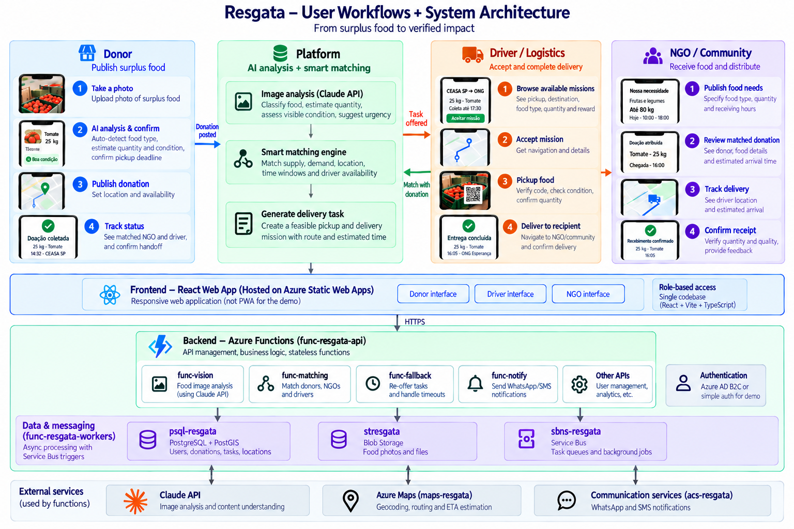
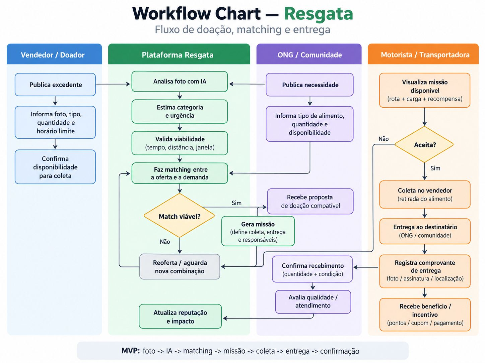
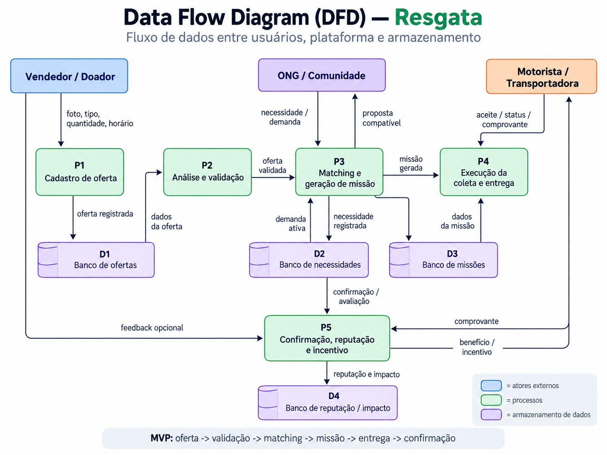

# Resgata

Resgata moves good surplus food from shops to the NGOs that need it, with
drivers who are already on the road. A shop photographs what is left, an NGO
says exactly what it needs, and the platform decides who receives it and who
carries it.

**Live demo:** https://gateway.purpledune-51104d3e.brazilsouth.azurecontainerapps.io
(Azure Container Apps, Brazil South). Pick a profile on *Quem é você?*: no
sign-up needed.



## Three innovations

### 1. Image analysis: a photo fills the donation

The shop owner taps **Tirar foto**. Claude (`claude-sonnet-5-5`, structured
output) reads the photo and returns:

- what the food is, the items visible, and a listing title in pt-BR;
- quantity and unit (kg, unidades, caixas, bandejas) and the total weight;
- condition (`good`, `attention`, `unsafe`) with a short note, and a
  conservative shelf life;
- estimated retail value per kg and the cost the shop would pay to discard it.

The form fills itself and every AI-filled field carries an **IA** tag until the
owner edits it. Quantity and weight stay coherent: changing the quantity
rescales the weight at the same weight per item. The pickup window is simple:
1h, 2h, 3h, or a custom time, never past the estimated shelf life. Food judged
`unsafe` or not food is refused by the API, so it never reaches an NGO. The
photo is stored in Blob Storage and shown to the NGO with the AI's condition
note.

Code: `services/api/src/claude-vision.ts`,
`apps/web/src/features/vision`, `apps/web/src/features/donations`.

### 2. Matching supply and demand

NGOs publish **Solicitações** with the exact item and amount
("Pão francês, 60 unidades até 19/10") and their receiving hours. Each new
donation is matched in two steps:

1. **Rules decide who can receive it:** service radius, road ETA against the
   food's shelf life, receiving hours, free capacity, accepted categories, and
   food safety.
2. **Claude rates how well it answers each eligible NGO's requests:** a fit
   from 0 to 1, how much of the request it covers in the request's own unit,
   and a one-line reason ("Bolo não substitui pão francês no café da manhã").

The score (0–100) weighs request fit 35%, distance 30%, shelf life 20%, and
space 15%. The best NGO gets the offer; if it declines or does not answer in
time, the next one does. Acceptance is atomic, so exactly one NGO wins.

Matching is explainable on both sides:

- the donor sees every NGO ranked, with distance, drive time, matched request,
  and why others were excluded;
- the NGO sees each offer's score broken into its four parts, and
  **Combinações recentes**: where it ranked on every recent donation in the
  area, Claude's reason, and who got the offer.

Every demo reset posts three fresh donations through the real pipeline, so the
NGO screen always shows live scores. Without an API key, a rule matcher
(category, shared words, comparable units) takes over.

Code: `services/workers/src/handlers/matching.ts`,
`services/workers/src/matching/need-matcher.ts`,
`apps/web/src/features/offers`, `apps/web/src/features/needs`.

### 3. Route optimization for drivers

Drivers are people already driving somewhere, more like BlaBlaCar than Uber.

- **Meu trajeto (trip mode).** The driver enters where they leave from, where
  they are going, and when. `POST /drivers/me/trip-match` ranks open deliveries
  by the minutes each adds to that trip, using Azure Maps road times and
  deadlines counted from the departure, and combines the best compatible set
  into one route that still ends at the driver's destination. The map shows
  the combined route over the dashed direct trip; ticking another delivery
  recomputes it.
- **Minhas entregas.** Accepted deliveries get an optimized stop order
  (`GET /drivers/me/route-plan`): every pickup precedes its delivery, a minute
  late weighs like ten minutes of driving, up to five deliveries are solved
  exactly (branch and bound), and larger loads use a greedy heuristic. The plan
  shows the minutes saved against the acceptance order.

Example from the demo (BCG Faria Lima → USP, leaving 16:00, live traffic):

| | Minutes | Result |
|---|---|---|
| Direct trip | 13 | — |
| Hortifruti Butantã → Casa de Acolhida Butantã | +8 | on the way |
| Padaria Funchal → Cozinha Solidária Butantã | +10 | on the way |
| Doceria Vila Olímpia (pickup by 16:02) | — | *não dá tempo* |
| Atacado Mooca → Banco de Alimentos Santana | +77 | wrong direction |
| **Combined route: both pickups, both drop-offs, then USP** | **34 (+20)** | **52 kg, +122 points** |

Code: `packages/shared/src/routing/plan.ts`,
`services/api/src/routes/tripMatch.ts`, `services/api/src/routes/routePlan.ts`,
`apps/web/src/features/pickups`.

## How the roles connect



| Role | Tabs | What they do |
|---|---|---|
| Doador (shop) | Doar · Minhas doações · Impacto | Photograph and publish surplus; see who is coming and the **pickup code** to give the driver; see kg checked by NGOs and rate the driver. |
| ONG | Doações · Solicitações · Entregas | Accept or decline offers; publish requests; see deliveries on the way with the **delivery code**; check in what arrived (weight and condition). |
| Motorista | Meu trajeto · Disponíveis · Minhas | Find deliveries on their trip; confirm pickup and delivery with the codes; earn points to trade in **Prêmios**. |

The codes close the loop: the shop holds the pickup code, the NGO holds the
delivery code, and the driver receives neither from the system. Statuses
refresh on every screen without reloading. Dashboards show a few headline
numbers, each tagged as recorded, calculated, or estimated.



## As deployed

The architecture image shows the target design. The hackathon deployment runs
the same code with a few simpler pieces:

| Piece | Target | Deployed now |
|---|---|---|
| Web | Azure Static Web Apps | Container App (nginx) behind a gateway Container App |
| API and workers | Azure Functions | Functions runtime in Container Apps |
| Queue | Service Bus | PostgreSQL-backed queue (`QUEUE_DRIVER=pg`) |
| Database, files | PostgreSQL + PostGIS, Blob Storage | Same (Flexible Server B1ms, Storage account) |
| AI, maps | Claude API, Azure Maps | Same (`claude-sonnet-5-5`; tiles, routes, matrix, and search through `/api/maps/*`, key never in the browser) |
| Sign-in, messages | Azure AD B2C, WhatsApp/SMS | Demo profiles; message outbox mock |

Deploy with `infra/azure/deploy.sh` (needs `az login`):

```bash
infra/azure/deploy.sh                          # infrastructure, images, apps
SKIP_INFRA=1 infra/azure/deploy.sh             # rebuild images and update apps
SKIP_INFRA=1 RESET_DB=1 infra/azure/deploy.sh  # also reload schema and demo data
```

## Workspace

```text
apps/web/            React 19, Vite, Tailwind, TanStack Query, Leaflet, PWA
packages/shared/     Zod contracts, state machine, matching score, route planner
services/api/        Azure Functions HTTP API (Claude vision, Azure Maps, trips)
services/workers/    outbox relay, matching with Claude, offer fallback, notifications
services/mocks/      local OpenAI, maps, and ACS mocks for offline runs
db/                  PostGIS migrations and demo seed (Campinas and São Paulo)
infra/               Azure deploy script, nginx gateway, emulator configuration
docs/                demo script, OpenAPI, contract changes, diagrams
```

## Run locally

Requirements: Docker Compose. Put keys in `.env` (git-ignored):

```bash
cp .env.example .env     # add ANTHROPIC_API_KEY and AZURE_MAPS_KEY
make lite                # PostgreSQL queue; `docker compose up -d --build` for Service Bus
```

- app and API through the gateway: `http://localhost:8080`;
- web dev server: `http://localhost:5173`;
- message outbox mock: `http://localhost:4003/outbox`.

Without `ANTHROPIC_API_KEY` the photo analysis uses the offline classifier and
matching uses rules; without `AZURE_MAPS_KEY` maps fall back to OpenStreetMap
and travel times to estimates. Everything else works the same.

## Demo

Reset before presenting (refreshes offers, open deliveries, and deadlines):

```bash
curl -X POST "$BASE/api/dev/reset" \
  -H 'X-Demo-User: platform-resgata' \
  -H "Idempotency-Key: reset-$(date +%s)"
```

The full walkthrough, with what the audience sees at each step, is in
[`docs/demo-script.md`](docs/demo-script.md). In short:

1. **Doador:** photo of bread → the form fills itself → publish → see why
   Instituto Prato Solidário was chosen.
2. **ONG:** the offer with its score → accept → *Combinações recentes*.
3. **Motorista:** *Meu trajeto* → type `bcg`, then `usp`, leave at 16:00 →
   deliveries on the way and the combined route → accept.
4. Pickup with the shop's code, delivery with the NGO's code, check-in at the
   NGO, impact and points updated.

Demo data is fictional and presented as real: shops, NGOs, and drivers in
Campinas, plus a São Paulo network along the BCG → USP road whose deadlines
are anchored to the next 16:00 on every reset.

## Validation

As of 2026-10-17:

- tests: shared 24, API 17, workers 17, mocks 3, web 122;
- lint, type checks, and the web dependency-boundary check pass;
- OpenAPI 3.1 validates (`docs/openapi.yaml`);
- the full loop (publish → match → accept → pickup code → delivery code →
  check-in) runs through the UI at phone size, locally and on Azure;
- `make smoke` and `make smoke-lite` cover idempotent replay, timeout
  fallback, and exactly one winner under concurrent acceptance.

## Decisions

- PostgreSQL is the source of truth; donation creation writes its event and
  outbox record in the same transaction, and every mutation is idempotent.
- Claude calls use structured output; rules always decide eligibility, so the
  model only ranks NGOs that can actually receive the food.
- Azure Maps is called only from the server; the browser gets tiles, routes,
  and search through `/api/maps/*`.
- Demo data is presented as real for the hackathon: `simulated` flags stay in
  the data, but the UI shows no "simulado" labels (`present_demo_as_real()`).

## Known gaps

- Sign-in is by demo profile; phone codes and WhatsApp delivery exist but are
  off in the deployment.
- Messages go to a mock outbox, not WhatsApp or SMS.
- Travel times use live traffic at request time, not traffic forecast for the
  departure.
- Camera and GPS need HTTPS on a real phone; see `docs/phone-testing.md`.
