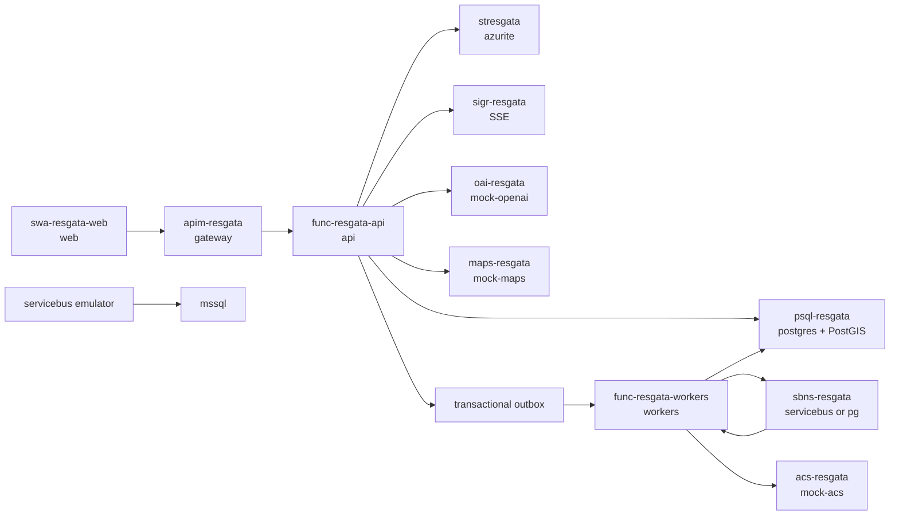

# Resgata

Resgata dispatches perishable food surplus to the most suitable NGO, retries
the next destination when an offer expires, and tracks collection, delivery,
notifications, coupons, and social impact.

The repository follows the product and architecture references under `docs/`.
Project-local Codex maintenance skills live under `.codex/skills/`.

## Delivery stages

| Stage | Scope | Status |
|---|---|---|
| 0 | pnpm monorepo, source documents, agent rules, maintenance skills | complete |
| 1 | shared contracts, state machine, matching, migrations, seed, OpenAPI | complete |
| 2 | Compose infrastructure, API, workers, mocks, and web foundations | complete |
| 3 | seller, NGO, driver, partner, admin, and offline features | complete |
| 4 | full/lite runtime integration, smoke tests, concurrency, and visual QA | complete |
| 5 | physical phone camera/GPS/PWA acceptance | documented, manual |

## Workspace

```text
apps/web/                 React, Vite, Tailwind, TanStack Query, PWA
packages/shared/          Zod contracts, state machine, haversine, matching
services/api/             Azure Functions HTTP application
services/workers/         outbox relay, matching, fallback, notifications
services/mocks/           deterministic OpenAI, maps, and ACS mocks
db/                       PostGIS migrations and fictional Campinas seed
infra/                    nginx gateway, TLS test proxy, emulator configuration
scripts/                  contract validation and end-to-end smoke
docs/handoffs/            staged multi-agent implementation records
.codex/skills/            architecture and multi-agent maintenance skills
```

## Architecture



All Azure-named services run locally. No Azure credential or live cloud call is
required.

## Run the full stack

Requirements: Docker Compose and enough memory for SQL Server. Copy the
development environment and start the default Azure-emulator profile:

```bash
cp .env.example .env
docker compose up -d --build
docker compose ps
```

Endpoints:

- web: `http://localhost:5173`;
- gateway and application: `http://localhost:8080`;
- API directly: `http://localhost:7071/api`;
- ACS message outbox: `http://localhost:4003/outbox`;
- Service Bus health: `http://localhost:5300/health`.

Every service should report healthy. Stop the stack with:

```bash
make down
```

## Lite mode

Machines that cannot run the SQL Server image can use PostgreSQL as the message
bus while preserving the same application behavior:

```bash
make lite
```

## Seed and reset

The seed contains fictional Campinas/SP data: sellers, NGOs, drivers,
partners, coupons, and historical donations.

```bash
make seed

curl -X POST http://localhost:8080/api/dev/reset \
  -H 'X-Demo-User: platform-resgata' \
  -H 'Idempotency-Key: reset-demo-001'
```

## Demo profiles

The `/entrar` screen selects a fictional identity and sends its key through
`X-Demo-User`:

- `seller-padaria-cambui`;
- `ngo-prato-solidario`;
- `driver-ana`;
- `partner-cafe-local`.

## Donation loop

The full loop from the product flowchart runs end to end:

1. **Sign in.** `/entrar` offers phone sign-in: a 6-digit code is sent through
   the notification channel (WhatsApp in production) and exchanged for a bearer
   session. Demo profiles stay available while `ENABLE_DEMO_LOGIN=true`.
2. **Photo analysis.** The vendor taps *Tirar foto*. Claude
   (`ANTHROPIC_MODEL`, default `claude-sonnet-5-5`) identifies the food,
   quantity, weight, shelf life, and condition, and prefills the form. The photo
   is kept in blob storage and shown to NGOs. The API rejects donations whose
   analysis is `unsafe` or not food.
3. **Pickup location.** The shop's registered address is the default. *Estou em
   outro local* uses phone GPS (HTTPS only) with OpenStreetMap reverse
   geocoding; typing a CEP fills the address through ViaCEP. Vendors can save a
   new address as the shop address.
4. **NGO demand.** NGOs publish specific requests under *Pedidos*: the item
   ("Pão francês"), quantity and unit (kg, unidades, caixas, bandejas),
   deadline, and notes, plus their daily receiving window and free capacity.
   Vendors see nearby requests on the donation screen.
5. **Matching.** Rules decide who *can* receive: service radius, road ETA
   (OSRM) against shelf life, receiving hours, free capacity, accepted
   categories, and food safety. Claude (`MATCHING_MODEL`, default
   `claude-sonnet-5-5`) then compares the donation, including the photo
   analysis, with each eligible NGO's open requests and returns a fit, the
   covered amount in the request's unit, and a reason. Request fit weighs 35%,
   distance 30%, shelf life 20%, capacity 15% (food flagged *attention* weighs
   distance more). Without a key, or if Claude fails, a rule matcher (category,
   shared words, comparable units) is used. Unanswered offers fall back to the
   next NGO after `OFFER_TIMEOUT_SECONDS`.
6. **Acceptance and delivery.** Accepting fills the matched request by the
   estimated amount when it is a real match (fit ≥ 0.7; substitutes leave the
   request open), uses
   today's capacity, notifies the seller, and alerts the three nearest available
   drivers whose vehicle fits the load. Drivers go online/offline, share their
   location, and see open pickups nearest first.

7. **Driver routes.** Drivers accept several deliveries at once and see an
   optimized stop order (`GET /drivers/me/route-plan`): every pickup precedes
   its delivery, deadlines weigh ten times more than driving minutes, and
   travel times come from the Azure Maps route matrix. Up to five deliveries
   are solved exactly; larger loads use a greedy heuristic. The plan shows the
   minutes saved versus the acceptance order on an Azure Maps map.

### External services

| Concern | Default | Production setting |
|---|---|---|
| Image analysis | Claude when `ANTHROPIC_API_KEY` is set, SIMULADO otherwise | `ANTHROPIC_API_KEY`, `ANTHROPIC_MODEL` |
| Maps, routes, address search | Azure Maps (`AZURE_MAPS_KEY`) via `/api/maps/*`; OpenStreetMap services as fallback | Same key; the browser never sees it |
| Addresses | ViaCEP + public Nominatim, SIMULADO fallback | Self-hosted Nominatim (`NOMINATIM_URL`) or `GEO_PROVIDER=simulated` |
| Road ETAs | Public OSRM demo server, straight-line fallback | Self-hosted OSRM (`OSRM_URL`) or `ROUTING_PROVIDER=none` |
| Messages | Local ACS mock (`:4003/outbox`) | `NOTIFICATION_PROVIDER=whatsapp` with `WHATSAPP_TOKEN`, `WHATSAPP_PHONE_NUMBER_ID`, and an approved `WHATSAPP_TEMPLATE_NAME` |
| Sign-in | Demo profiles plus phone codes echoed on screen | `ENABLE_DEMO_LOGIN=false`, `ENABLE_DEV_LOGIN_CODES=false` |

The public OSRM and Nominatim servers are for light testing only; their usage
policies forbid production traffic. WhatsApp business-initiated messages need
an approved template with one body variable (`{{1}}`), which receives the
message text.

For the hackathon walkthrough that proves matching with live posts, see
[`docs/demo-script.md`](docs/demo-script.md).

## Three-minute demo

1. Open `/entrar`, choose **Padaria Cambuí**, classify or describe surplus,
   and publish it.
2. Switch to **ONG Prato Solidário**, inspect the explainable matching score,
   and accept the pending offer.
3. Switch to **Ana — motorista**, assume the route, confirm collection and
   delivery with the six-digit demo codes and location.
4. Return to the seller impact dashboard and inspect the live donation state.
5. Open the ACS outbox on port 4003 to show offer, collection, and delivery
   notifications.
6. Open `/admin/queues` to show outbox, jobs, events, correlation IDs, and
   dead-letter replay controls.

Set `OFFER_TIMEOUT_SECONDS=5` before startup to demonstrate automatic fallback
to the next NGO.

## Validation

Automated validation completed on 2026-10-16:

- shared domain: 9 tests;
- API: 5 tests;
- workers: 9 tests;
- mocks: 3 tests;
- web: 34 tests across 14 files;
- OpenAPI parsing and clean PostGIS migration/seed validation;
- production PWA build with 13 precached entries;
- architecture-boundary lint for 127 web source files;
- full Service Bus profile smoke: happy path, idempotent replay, timeout
  fallback, and exactly one winner under concurrent acceptance;
- lite PostgreSQL-driver smoke with the same scenarios;
- browser QA for seller, NGO, driver, and partner routes;
- responsive QA at 390 by 844 with no horizontal document overflow.

Run the full smoke:

```bash
make smoke
make smoke-lite
```

## HTTPS phone testing

Camera, GPS, and installability require a secure context on a physical device.
The trusted-LAN certificate and temporary nginx TLS proxy procedure is in
`docs/phone-testing.md`.

## Maintenance skills

- `.codex/skills/resgata-multi-agent`: ownership, handoffs, gates, and
  subagent integration.
- `.codex/skills/resgata-web-architecture`: route shells, dependency
  boundaries, providers, contracts, and feature maintenance.

Both skills were generated with the Codex skill-creator workflow and validated
with its structural validator.

## Decisions

- The original Vite PWA was retained and moved into the pnpm monorepo.
- PostgreSQL is the source of truth; no browser or service owns a separate
  fictional dataset.
- Every mutation uses correlation and idempotency metadata where applicable.
- Donation creation writes its event and transactional outbox record in the
  same database transaction.
- Atomic database transitions enforce a single winner for concurrent offer
  acceptance.
- Service Bus is the default transport; PostgreSQL scheduling remains the
  deterministic timeout source because the emulator does not provide
  production-equivalent scheduled-message behavior.
- The API keeps public `/api/admin/*` compatibility while Azure Functions uses
  internal `/api/ops/*` routes because `/admin` is reserved by the Functions
  host.
- Dashboard routes use a desktop shell that collapses into a wrapped,
  overflow-free header on narrow screens.
- The current worktree contains root-level `@azure/mcp` tooling that requires
  Node 22 on the host. Application runtime images remain pinned to Node 20 and
  install only their filtered workspace dependencies.

## Known gaps

- Service Bus emulator state is non-persistent and lacks AMQP WebSockets,
  partitioned entities, Entra ID, autoscale, disaster recovery, large-message
  support, and production observability/SLA. See `docs/emulator-notes.md`.
- SSE is implemented as a bounded resumable stream with `Last-Event-ID`, not a
  permanently held managed SignalR connection.
- Maps are represented by deterministic local routing/location data; live OSM
  tiles are intentionally not required so the demo remains offline.
- QR scanning uses the browser `BarcodeDetector` when available and always
  provides a six-digit manual fallback; browser support differs from the
  production-grade ZXing path.
- Camera, GPS permission behavior, PWA installation, and offline replay still
  require the documented physical-phone acceptance pass.
