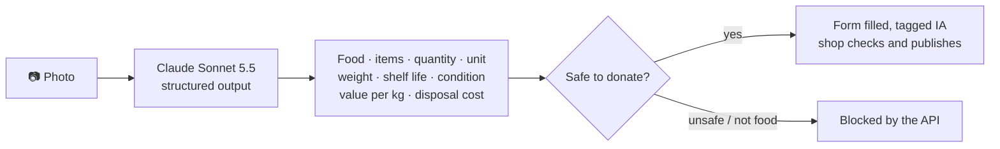
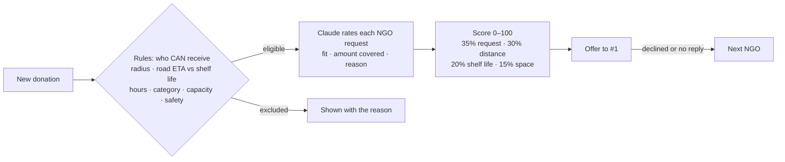
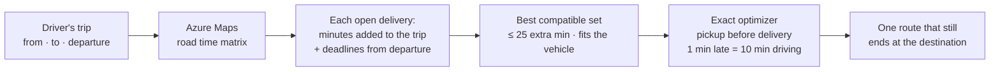
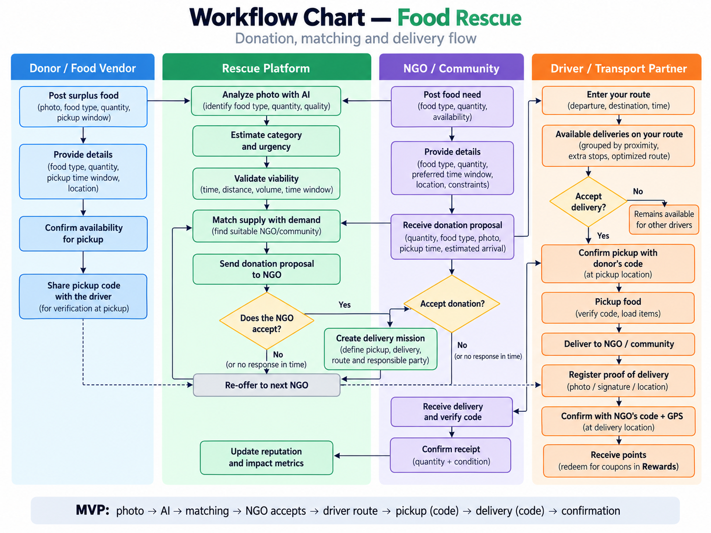
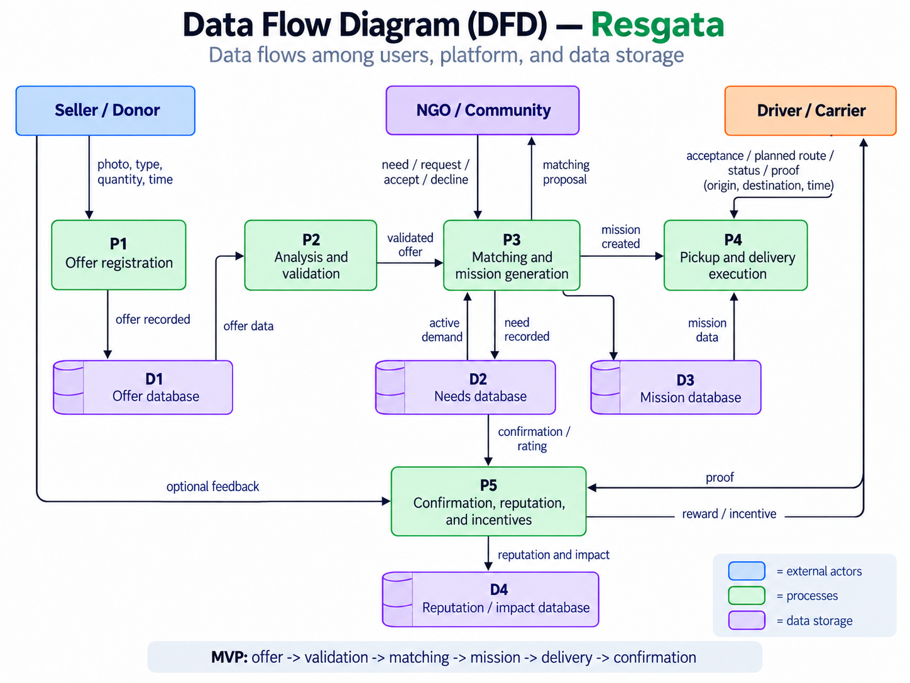

<div align="center">

# Resgata

**Surplus food → the right NGO → a driver already on the way.**

A shop photographs what is left, an NGO says exactly what it needs, and a
driver who is already driving picks it up on the way.

[**Open the live demo**](https://gateway.purpledune-51104d3e.brazilsouth.azurecontainerapps.io) ·
[Demo script](docs/demo-script.md) ·
[API](docs/openapi.yaml)


</div>

## Three innovations

| | Innovation | In one sentence |
|:---:|---|---|
| **1** | [**Image analysis**](#1-image-analysis) | One photo fills the donation: food, amount, weight, shelf life, safety, even value and disposal cost. |
| **2** | [**Matching supply and demand**](#2-matching-supply-and-demand) | Rules decide who *can* receive the food; Claude rates who *needs* it most. Every NGO gets a 0–100 score and a reason. |
| **3** | [**Route optimization for drivers**](#3-route-optimization-for-drivers) | Like BlaBlaCar, not Uber: deliveries are matched to a trip the driver already makes, and combined into one optimized route. |

---

## 1. Image analysis




- **Less typing for a busy shop owner.** Every field the AI fills carries an
  **IA** tag until the owner changes it.
- **Numbers stay coherent.** Changing the quantity rescales the weight at the
  same weight per item; the pickup window (1h, 2h, 3h, or a custom time) never
  goes past the estimated shelf life.
- **Safety first.** Food judged `unsafe` (mold, spoilage, unrefrigerated
  perishables) never reaches an NGO. The photo is kept and shown to the NGO
  with the AI's condition note.

<sub>Code: [`services/api/src/claude-vision.ts`](services/api/src/claude-vision.ts) ·
[`apps/web/src/features/donations`](apps/web/src/features/donations) ·
[`apps/web/src/features/vision`](apps/web/src/features/vision)</sub>

---

## 2. Matching supply and demand




- **NGOs say exactly what they need** ("Pão francês, 60 unidades até 19/10"),
  not just a category, so a cake goes to the NGO planning a party and bread to
  the one serving breakfast.
- **Explainable on both sides.** The donor sees every NGO ranked with distance,
  drive time, matched request, and why others were excluded. The NGO sees its
  score broken into four parts and *Combinações recentes*: where it ranked on
  every recent donation, and Claude's reason.
- **Reliable.** Acceptance is atomic (exactly one NGO wins), unanswered offers
  move on automatically, and a rule matcher takes over if Claude is
  unavailable.

<sub>Code: [`services/workers/src/handlers/matching.ts`](services/workers/src/handlers/matching.ts) ·
[`services/workers/src/matching/need-matcher.ts`](services/workers/src/matching/need-matcher.ts) ·
[`apps/web/src/features/offers`](apps/web/src/features/offers)</sub>

---

## 3. Route optimization for drivers




The demo trip, live: **BCG (Faria Lima) → USP, leaving 16:00.**

| Open delivery | Minutes added | Result |
|---|---:|---|
| Hortifruti Butantã → Casa de Acolhida Butantã | +8 | ✅ on the way |
| Padaria Funchal → Cozinha Solidária Butantã | +10 | ✅ on the way |
| Empório Pinheiros → Instituto Rio Pequeno | +19 | possible detour |
| Doceria Vila Olímpia (pickup by 16:02) | — | ⏱ *não dá tempo* |
| Atacado Mooca → Banco de Alimentos Santana | +77 | ❌ wrong direction |
| **Combined: both pickups, both drop-offs, then USP** | **13 → 35 min** | **52 kg rescued, +122 points** |

- **The driver keeps their plan.** Deliveries ride along on a trip they make
  anyway; the map shows the combined route over the dashed direct trip, and
  ticking another delivery recomputes it instantly.
- **Deadlines are real.** Pickup and delivery windows are checked against the
  departure time with live road times, so a delivery that cannot make it says
  so instead of being late.
- **Optimal for small loads.** Up to five deliveries are solved exactly
  (branch and bound); larger loads use a greedy heuristic. Accepted deliveries
  keep the optimized order under *Minhas*.

<sub>Code: [`packages/shared/src/routing/plan.ts`](packages/shared/src/routing/plan.ts) ·
[`services/api/src/routes/tripMatch.ts`](services/api/src/routes/tripMatch.ts) ·
[`apps/web/src/features/pickups`](apps/web/src/features/pickups)</sub>

---

## How the roles connect



| Role | Tabs | What they do |
|---|---|---|
| 🏪 **Doador** (shop) | Doar · Minhas doações · Impacto | Photograph and publish surplus; see who is coming and the **pickup code** to give the driver; see kg checked by NGOs and rate the driver. |
| 🏠 **ONG** | Doações · Solicitações · Entregas | Accept or decline offers; publish requests; see deliveries on the way with the **delivery code**; check in what arrived. |
| 🚚 **Motorista** | Meu trajeto · Disponíveis · Minhas | Find deliveries on their trip; confirm pickup and delivery with the codes; trade points for rewards in **Prêmios**. |

The codes close the loop: the shop holds the pickup code, the NGO holds the
delivery code, and the driver receives neither from the system.

## Architecture


Deployed on **Azure Container Apps (Brazil South)**: React PWA behind an nginx
gateway, the API and workers on the Azure Functions runtime, PostgreSQL +
PostGIS (also the job queue; Service Bus in production), Blob Storage for
photos, Claude Sonnet 5.5, and Azure Maps (tiles, routes, matrix, search, always
through `/api/maps/*` so the key never reaches the browser). The demo signs in
with profiles and sends messages to a mock outbox; Azure AD B2C and
WhatsApp/SMS are the production path.



## Try it

**Live:** open the [demo](https://gateway.purpledune-51104d3e.brazilsouth.azurecontainerapps.io)
and pick a profile, no sign-up. Reset before presenting (refreshes offers and
the São Paulo trip deliveries):

```bash
curl -X POST "https://gateway.purpledune-51104d3e.brazilsouth.azurecontainerapps.io/api/dev/reset" \
  -H 'X-Demo-User: platform-resgata' -H "Idempotency-Key: reset-$(date +%s)"
```

**Locally** (Docker Compose):

```bash
cp .env.example .env     # add ANTHROPIC_API_KEY and AZURE_MAPS_KEY
make lite                # app on http://localhost:8080
```

Without keys, photo analysis uses an offline classifier, matching uses rules,
and maps fall back to OpenStreetMap; everything else works the same.

**Deploy** (`az login` first):

```bash
SKIP_INFRA=1 infra/azure/deploy.sh             # rebuild images and update apps
SKIP_INFRA=1 RESET_DB=1 infra/azure/deploy.sh  # also reload schema and demo data
```

## Repository

```text
apps/web/              React 19, Vite, Tailwind, TanStack Query, Leaflet, PWA
packages/shared/       Zod contracts, matching score, route planner
services/api/          HTTP API: Claude vision, Azure Maps, trip matching
services/workers/      outbox relay, matching with Claude, offer fallback
db/                    PostGIS migrations; demo data for Campinas and São Paulo
infra/azure/           deployment script
tools/readme-media/    Remotion source of the animations above
docs/                  demo script, OpenAPI, diagrams, contract changes
```

The animations use real screens from the running app. To regenerate them:
`cd tools/readme-media && npm install && npm run render`.

## Quality

- Tests: shared 24 · API 17 · workers 17 · mocks 3 · web 122; lint, types, and
  the web dependency-boundary check pass; OpenAPI 3.1 validates.
- The full loop (photo → match → accept → pickup code → delivery code →
  check-in) is exercised through the UI at phone size, locally and on Azure.
- `make smoke` covers idempotent replay, offer timeout fallback, and exactly
  one winner under concurrent acceptance.
- Demo data is fictional and presented as real; travel times use live
  traffic, so minutes vary slightly by hour.
